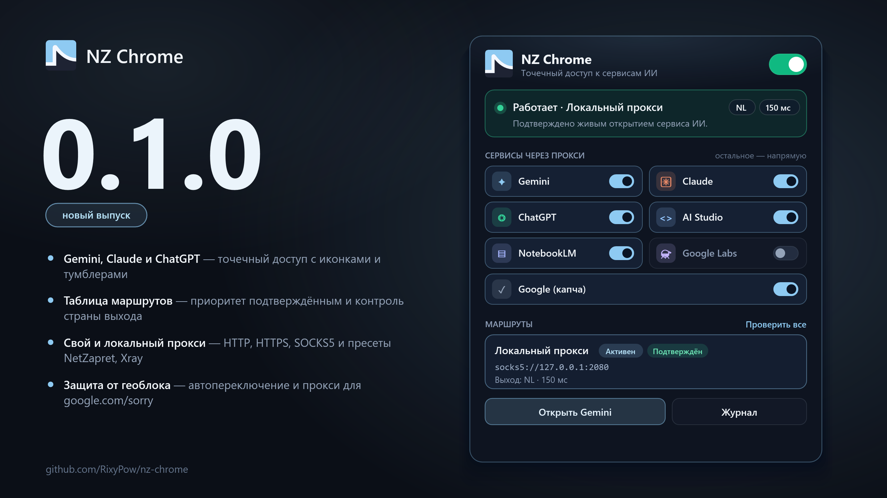

# Что нового в 0.1.0

Первый выпуск **NZ Chrome** — лёгкого расширения для браузеров на Chromium (Chrome, Edge, Яндекс.Браузер, Brave), которое направляет в прокси только выбранные сервисы ИИ, оставляя весь остальной трафик браузера (включая вход в аккаунт Google) напрямую.

## Сервисы

### Новое:

**Gemini, Claude, ChatGPT и сервисы Google AI.** В окне расширения собраны отдельные переключатели-тумблеры с иконками для Gemini, Claude, ChatGPT, AI Studio, NotebookLM и Google Labs.

**Точечный режим для `google.com/sorry`.** Переключатель «Google (капча)» направляет через прокси строго `google.com` и `www.google.com`, не затрагивая `accounts.google.com`, почту и диск. Если при открытии Gemini на странице проверки Google появляется несовпадение IP (`≠`), расширение предлагает включить этот режим в один клик прямо на странице.

## Маршруты

### Новое:

**Таблица маршрутов с доказательством работы.** Маршрут, на котором реально открылся интерфейс Gemini, Claude или ChatGPT без региональной заглушки, всегда стоит выше просто быстрого маршрута.

**Свой и локальный прокси.** Поддерживаются `http://`, `https://` (включая авторизацию `user:pass@host:port`), `socks5://` и `socks4://`. Пароли скрываются в интерфейсе и журнале. Добавлены быстрые пресеты для локальных прокси NetZapret / sing-box (`127.0.0.1:2080`), Xray / v2rayN и Clash.

## Проверка и обход

### Новое:

**Контроль страны выхода.** Каждый маршрут проверяется изолированно через `cp.cloudflare.com/cdn-cgi/trace`, не прерывая работу активного маршрута. Прокси с выходом в заблокированных регионах (`RU`, `BY`, `CN` и др.) отключаются автоматически.

**Автопереключение при геоблоке.** Детектор на страницах Gemini, Claude и ChatGPT распознаёт региональный отказ, отправляет проблемный маршрут на нарастающую паузу (2 мин → 10 мин → 1 ч → 6 ч) и переключает PAC на следующий живой маршрут.

## Интерфейс

### Новое:

**Оформление NZ Chrome в пастельно-голубой палитре.** Фирменный логотип в стиле NetZapret с пастельно-голубым верхом, карточка состояния-светофор с пилюлями страны и задержки, бейдж с кодом страны на иконке расширения, определение конфликта с другими прокси-расширениями и встроенный журнал событий.
