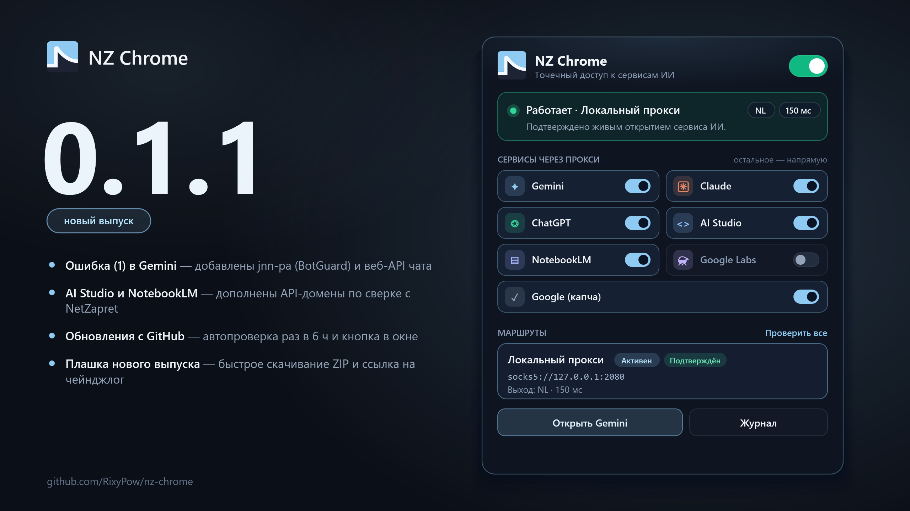

# Что нового в 0.1.1

## Сервисы

### Исправления:

**Ошибка (1) при отправке сообщений в Gemini.** В список доменов Gemini добавлены `jnn-pa.googleapis.com` (аттестация Google BotGuard, привязанная к IP), `geminiweb-pa.clients.google.com`, `geminiweb-pa.clients6.google.com`, `robinfrontend-pa.googleapis.com`, `gemini.google` и `gemini.gstatic.com`. Раньше токен BotGuard мог уходить напрямую с российского IP, из-за чего чат отвечал «Что-то пошло не так. (1)».

**Дополнены домены AI Studio и NotebookLM.** Добавлены `ai.studio`, `webchannel-alkalimakersuite-pa.clients6.google.com`, `alkalicore-pa.clients6.google.com`, `notebooklm-pa.googleapis.com` и `notebooklm.googleapis.com` по сверке с NetZapret.

## Обновление

### Новое:

**Проверка обновлений с GitHub.** Расширение само проверяет свежие выпуски на GitHub раз в 6 часов; внизу окна появилась строка версии и кнопка «Проверить обновления». При выходе новой версии сверху показывается пастельно-голубая плашка с кнопками «Скачать» (прямой `.zip`) и «Что нового».
